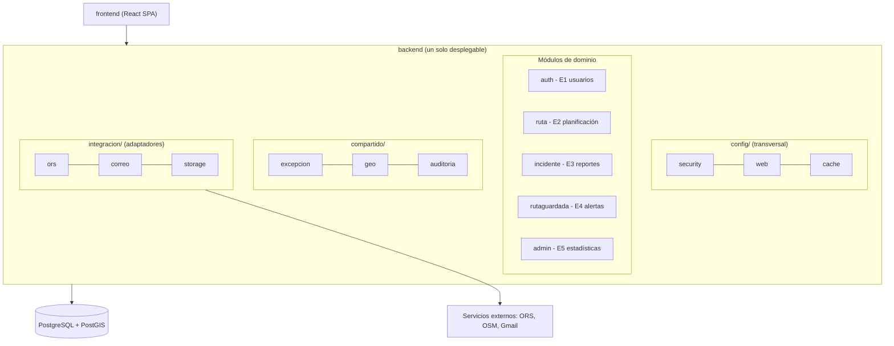

# BiciSafe

Plataforma de **ciclorutas seguras y reporte comunitario** para Lima Sur. Permite planificar rutas
en bicicleta, reportar y validar incidencias de forma comunitaria, y administrar los parámetros del
sistema. El proyecto está organizado como un **monolito modular**.

## Stack tecnológico

| Capa | Tecnología |
|------|------------|
| Backend | Java 21, Spring Boot 4.1.1, Maven, Spring Security + JWT, Spring Data JPA, Flyway |
| Base de datos | PostgreSQL + PostGIS |
| Caché | Caffeine |
| API docs | springdoc OpenAPI (Swagger UI) |
| Frontend | React 18 + TypeScript, Vite, Tailwind CSS, Leaflet |
| Servicios externos | OpenRouteService, OpenStreetMap (tiles/Nominatim), Gmail SMTP |
| Infra / CI | Docker Compose (opcional), GitHub Actions, despliegue en Render |

## Patrón arquitectónico: monolito modular

Un **único desplegable** (un proceso Spring Boot) dividido internamente en **módulos por dominio**.
No es un monolito en capas globales, sino en módulos autocontenidos con límites explícitos.

Principios:

- **Un módulo por épica/dominio**: cada módulo agrupa su propio `controller`, `service`,
  `repository`, `domain` y `dto`. Nada de un `controller/` o `service/` gigante para todo el sistema.
- **Comunicación entre módulos por interfaces**: un módulo expone un `service` (API interna) y otro
  la consume; **no** se accede directamente al `repository` de otro módulo.
- **Dependencias hacia adentro**: `controller → service → repository → domain`. La lógica de negocio
  vive en el `service`/`domain`, nunca en el `controller`.
- **Transversal en `config/`**: seguridad (JWT/RBAC), CORS y manejo global de errores, caché.
- **Compartido en `compartido/`**: utilidades comunes (excepciones de negocio, conversión
  GeoJSON ↔ PostGIS, auditoría).
- **Integraciones en `integracion/`**: adaptadores a servicios externos. Cada adaptador **implementa
  una interfaz (puerto)** definida por el módulo que la necesita (patrón puertos y adaptadores),
  de modo que el dominio no dependa de SDKs/HTTP concreto.

Beneficios: límites claros entre dominios, bajo acoplamiento, pruebas por módulo y una ruta natural
para extraer un módulo a microservicio si algún día hiciera falta (sin reescribir la lógica).



## Estructura del repositorio

```
bicisafe/
├─ backend/                                  API REST (Java 21, Spring Boot, Maven)
│  ├─ src/main/java/pe/edu/untels/bicisafe/
│  │  ├─ BiciSafeApplication.java            punto de entrada
│  │  ├─ config/                             configuración transversal
│  │  │  ├─ security/                        filtro JWT, reglas RBAC, BCrypt
│  │  │  ├─ web/                             CORS, manejo global de errores
│  │  │  └─ cache/                           configuración de Caffeine
│  │  ├─ compartido/                         utilidades comunes a todos los módulos
│  │  │  ├─ excepcion/                       excepciones de negocio
│  │  │  ├─ geo/                             conversión GeoJSON ↔ geometrías PostGIS
│  │  │  └─ auditoria/                       registro de acciones
│  │  ├─ auth/                               E1 Gestión de usuarios y perfiles
│  │  ├─ ruta/                               E2 Planificación de rutas
│  │  ├─ incidente/                          E3 Reporte y validación comunitaria
│  │  ├─ rutaguardada/                       E4 Rutas guardadas y alertas
│  │  ├─ admin/                              E5 Administración y estadísticas
│  │  └─ integracion/                        adaptadores de servicios externos
│  │     ├─ ors/                             OrsAdapter (implementa ProveedorRutas)
│  │     ├─ correo/                          CorreoAdapter (implementa ServicioCorreo)
│  │     └─ storage/                         FotoStorageAdapter
│  ├─ src/main/resources/
│  │  ├─ application.yml                     perfiles dev/prod (secretos por variables de entorno)
│  │  └─ db/migration/                       scripts Flyway V1__..., V2__...
│  ├─ src/test/java/pe/edu/untels/bicisafe/  pruebas unitarias, de integración y ArchUnit
│  ├─ Dockerfile                             imagen para Render (pendiente)
│  └─ pom.xml
├─ frontend/                                 SPA (React 18 + TS, Vite, Tailwind)
│  ├─ src/
│  │  ├─ main.tsx  │  App.tsx                arranque y rutas de navegación
│  │  ├─ pages/                              una página por pantalla (Login, Mapa, Ruta, Admin…)
│  │  ├─ components/                         reutilizables (mapa, incidentes, rutas, layout, comunes)
│  │  ├─ hooks/                              lógica reutilizable (useAuth, useGeolocalizacion…)
│  │  ├─ context/                            sesión del usuario (token JWT)
│  │  ├─ services/                           cliente HTTP de la API REST
│  │  ├─ types/                              tipos TypeScript
│  │  ├─ utils/                              formatos y validaciones
│  │  └─ styles/                             estilos y variables de color accesibles
│  ├─ public/
│  ├─ tests/                                 pruebas con Vitest y Testing Library
│  └─ package.json
├─ docs/
│  ├─ arquitectura/                          diagramas C4 (Mermaid) y ADR
│  ├─ api/                                   especificación OpenAPI
│  └─ cambios/                               registro de cambios (qué, ruta y por qué)
├─ docker-compose.yml                        PostGIS local (opcional)
├─ .env.example                              variables de entorno de referencia
├─ .github/workflows/                        CI: compilar, probar y desplegar (pendiente)
└─ README.md
```

## Módulos del backend

| Módulo | Épica | Responsabilidad |
|--------|-------|-----------------|
| `auth` | E1 | Gestión de usuarios, perfiles, autenticación (JWT) y RBAC. |
| `ruta` | E2 | Planificación de rutas (integra OpenRouteService). |
| `incidente` | E3 | Reporte y validación comunitaria de incidencias (fotos, ubicación, votación). |
| `rutaguardada` | E4 | Rutas guardadas por el usuario y alertas. |
| `admin` | E5 | Administración de parámetros y estadísticas. |
| `config` | — | Seguridad, CORS/errores, caché (transversal). |
| `compartido` | — | Excepciones, geo (GeoJSON↔PostGIS), auditoría. |
| `integracion` | — | Adaptadores: ORS, correo (Gmail SMTP), almacenamiento de fotos. |

## Cómo ejecutar

Requisitos: **JDK 21**, **Node 18+** y una **base PostgreSQL con PostGIS** (existente o vía
`docker compose up -d`). La configuración de conexión se toma de variables de entorno (ver
`.env.example`); por defecto en `dev` apunta a `jdbc:postgresql://localhost:5432/bicisafe`.

### Linux / macOS

```bash
# Backend (aplica migraciones Flyway al arrancar)
cd backend && ./mvnw spring-boot:run

# Frontend
cd frontend && npm install && npm run dev
```

### Windows (CMD o PowerShell)

```bat
:: Backend (usa el wrapper .cmd)
cd backend
mvnw.cmd spring-boot:run

:: Frontend (en otra terminal)
cd frontend
npm install
npm run dev
```

> En Windows también puedes usar **Git Bash** o **WSL** y seguir los comandos de Linux.
> El archivo `docker-compose.yml` funciona igual con **Docker Desktop**.

### Variables de entorno

Copia `.env.example` a `.env` y ajusta los valores, o defínelos en el sistema:

```bat
:: Windows CMD
set DB_URL=jdbc:postgresql://localhost:5432/bicisafe
set DB_USERNAME=user
set DB_PASSWORD=1234
```

```powershell
# Windows PowerShell
$env:DB_URL = "jdbc:postgresql://localhost:5432/bicisafe"
$env:DB_USERNAME = "user"
$env:DB_PASSWORD = "1234"
```

Variables principales: `DB_URL`, `DB_USERNAME`, `DB_PASSWORD`, `JWT_SECRET`, `ORS_API_KEY`,
`MAIL_*`. Detalle de cada una en `.env.example`. Spring Boot **no** lee `.env` por sí solo: úsalo
como referencia, pásalo con `envFile` de VS Code, o defínelo como variables del sistema/IDE.

> **Base de datos en Windows:** lo más simple para tener PostGIS es **Docker Desktop** con
> `docker compose up -d`. Si usas PostgreSQL nativo, instala la extensión **PostGIS** (Stack
> Builder) o habilítala en tu proveedor; la migración `V1` la requiere.

## Estándares de código

Buscamos **código legible, simple, mantenible y bien documentado**. La regla de oro: que el próximo
que lea el archivo entienda *qué hace* y *por qué* sin tener que ejecutarlo.

### Principios

- **Legibilidad primero**: el código se lee muchas más veces de las que se escribe. Prioriza claridad
  sobre ingenio.
- **Simple (KISS)**: la solución más sencilla que resuelva el problema. Evita sobre-ingeniería.
- **No te repitas (DRY)**, pero sin crear abstracciones prematuras; la duplicación es preferible a la
  abstracción equivocada.
- **YAGNI**: no agregues código para necesidades que aún no existen.
- **SOLID** donde aplique, especialmente responsabilidad única y dependencias invertidas (interfaces
  en los dominios, implementaciones en `integracion/`).

### Idioma

- **Identificadores, comentarios, Javadoc/TSDoc y mensajes de commit: en inglés** (estándar de la
  industria, facilita colaboración y herramientas).
- **Documentación (`README`, `docs/`)** y **textos visibles al usuario** (mensajes de UI, correos):
  **en español**.

### Nombres

- Nombres **descriptivos y sin abreviaturas crípticas** (`calcularDistanciaSegura`, no `calcDist`).
- Java: clases `PascalCase`, métodos/variables `camelCase`, constantes `UPPER_SNAKE_CASE`, paquetes
  en minúsculas. TypeScript: componentes `PascalCase`, hooks `useAlgo`, tipos `PascalCase`.
- Evita prefijos húngaros y nombres genéricos (`data`, `info`, `manager`) cuando algo más específico
  sea posible.

### Comentarios y documentación

- Los comentarios explican **el por qué, no el qué**. El *qué* debe ser evidente por el propio código.
- **Javadoc** en APIs públicas (clases de servicio, métodos expuestos, DTOs relevantes): propósito,
  parámetros, retorno y excepciones. **TSDoc** en hooks/servicios del frontend.
- Evita comentarios que repiten el código (`// suma 1`). Prefiere código autoexplicativo y, si el
  *por qué* no es obvio (decisión de negocio, workaround, referencia a una regla), entonces comenta.
- Marca pendientes con contexto: `// TODO(#123): ...`, `// FIXME: ...`, no `// TODO` pelado.

```java
// Bad: restates the code
// increment counter
counter++;

// Good: explains a non-obvious reason
// The ORS free tier rejects bursts; keep at least 1 request/second between calls.
Thread.sleep(Duration.ofSeconds(1));
```

### Backend

- **Inyección por constructor** (no `@Autowired` en campos).
- **Controller delgado**: solo traduce HTTP ↔ casos de uso; la lógica vive en `service`/`domain`.
- **Nunca exponer entidades JPA**: usar `dto` para entrada y salida; mapear con MapStruct.
- Validar la entrada con **Bean Validation** (`@Valid`, anotaciones en los DTOs).
- **`@Transactional` en la capa de servicio**, no en el repositorio ni en el controlador.
- Errores de negocio con excepciones propias de `compartido/excepcion`, traducidas a respuestas HTTP
  por el manejador global (`config/web`).
- Métodos cortos, una sola responsabilidad, *early return* para evitar anidamiento profundo.

### Frontend

- Componentes **funcionales** y **hooks**; sin lógica de negocio compleja dentro del JSX.
- **TypeScript estricto**: prohibido `any` (usa tipos/uniones); los tipos compartidos van en `types/`.
- Separar **presentación** (`components/`), **acceso a datos** (`services/`) y **estado** (`context/`,
  `hooks/`). Un componente no llama a `fetch` directamente: usa un servicio.
- **ESLint + Prettier** para estilo uniforme; **Vitest + Testing Library** para pruebas.

### Pruebas

- **Unitarias** para reglas de negocio y **de integración** para controladores/repositorios.
- Nombres de test descriptivos del comportamiento, no del método
  (`shouldRejectReportWhenUserIsBanned`).
- **ArchUnit** para proteger las reglas de esta arquitectura (p. ej. que `controller` no acceda a
  `repository`, o que los módulos no se acoplen directamente).

### Formato y control de versiones

- Formateo automático (backend: `google-java-format` o el formatter del IDE; frontend: Prettier).
  Regla práctica: 100–120 columnas, sin `import` sin usar.
- **Commits con [Conventional Commits](https://www.conventionalcommits.org/)**:
  `feat(auth): add JWT refresh endpoint`, `fix(ruta): handle empty ORS response`.
- Ramas con prefijo: `feat/…`, `fix/…`, `docs/…`.

## Documentación

Los cambios técnicos se documentan en [`docs/cambios/`](docs/cambios/README.md), un archivo por
cambio con **qué** se hizo, **la ruta** de los archivos y **por qué**. Revisa ese índice para
conocer el historial del proyecto.
